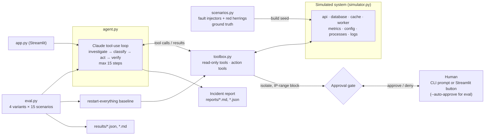

# FixBot SecOps

Agentic incident response for a failing system (Hackathon Challenge 1).

## Problem

When a production system goes red at 3am, the on-call engineer first has to work out *what kind* of problem it is: something that broke on its own, like a full disk, a memory leak or a bad deploy, or something someone is doing to it, like a brute-force login, a crypto miner or a leaked key. The fix depends on the answer, and the usual runbook, "restart it", fixes almost none of the security cases while destroying evidence. FixBot SecOps is a Claude-powered agent that investigates a failing system and classifies the incident as **reliability** or **security**. It applies the least disruptive fix and asks a human before risky actions. It then **verifies** recovery with a health check, loops until the system is healthy, and writes an incident report with root cause, evidence, actions with reasons and proof of recovery.

## Architecture



| File | Role |
|---|---|
| `simulator.py` | Deterministic system with 4 services and `health_check()` |
| `scenarios.py` | 10 fault injectors, double faults, red-herring logs; 10 dev and 5 held-out scenarios with expected root cause and fix |
| `toolbox.py` | The agent's tools over the simulator. Correct fixes heal it; wrong ones don't |
| `agent.py` | Claude loop, approval callback, incident report, CLI |
| `eval.py` | Runs every scenario for every variant, scores it, writes `results/` |
| `app.py` | Streamlit UI: service cards, live agent log, Approve button, report |

**Tools.** Read-only: `get_metrics`, `read_logs`, `get_config`, `list_processes`, `get_auth_logs`, `health_check`. Actions: `restart`, `clear_disk`, `rollback_config`, `scale`, `block_ip`, `kill_process`, `isolate`, `rotate_secret`. Control: `classify_incident`, `submit_report`. No tool deletes data: `clear_disk` compresses logs and moves them to an archive, and `rollback_config` restores the last known-good config.

## Install and run

Requires Python 3.10+ (developed on macOS with `python3`).

```bash
python3 -m venv .venv
source .venv/bin/activate
pip install -r requirements.txt
echo "ANTHROPIC_API_KEY=sk-ant-..." > .env
```

```bash
python agent.py --list                                   # list scenarios
python agent.py --scenario crypto_miner                  # Haiku (dev model), asks before risky actions
python agent.py --scenario brute_force_login --auto-approve --model claude-sonnet-5-5
streamlit run app.py                                     # UI at http://localhost:8501
python eval.py                                           # full eval with Sonnet, writes results/
python eval.py --model claude-haiku-5-5 --variants full --split dev   # cheaper partial run
python test_simulator.py && python test_scenarios.py && python test_toolbox.py   # offline tests, no API
```

**Network note.** The client connects to the API over IPv4. On the development network, the IPv6 route sometimes took 2–11s to connect or hung completely, which made some agent turns take minutes. Set `FIXBOT_IPV6=1` to use the default dual-stack behavior. A request that gets no answer within 40s is retried, and the retry shows up in the agent log.

The model is a setting: `--model` (or the `FIXBOT_MODEL` env var). Development used `claude-haiku-5-5`; the final eval uses `claude-sonnet-5-5`.

## Scenarios

Each scenario is deterministic from its seed and adds 3 harmless but alarming-looking log lines as red herrings.

| Scenario | Split | Type | Faults | Expected fix |
|---|---|---|---|---|
| disk_full | dev | reliability | disk_full | `clear_disk(database)` |
| memory_leak | dev | reliability | memory_leak | `restart(worker)` |
| bad_config | dev | reliability | bad_config | `rollback_config(api)` |
| conn_pool_exhausted | dev | reliability | conn_pool_exhausted | `restart(database)` |
| brute_force_login | dev | security | brute_force_login | `block_ip(198.51.100.0/24)` |
| crypto_miner | dev | security | crypto_miner | `kill_process(worker, kworker-upd)` |
| legit_traffic_spike | dev | reliability | legit_traffic_spike | `scale(api, 8)` |
| double_leak_and_bruteforce | dev | security | memory_leak + brute_force_login | both fixes |
| double_disk_and_badconfig | dev | reliability | disk_full + bad_config | both fixes |
| double_attack_and_pool | dev | security | attack_spike + conn_pool_exhausted | both fixes |
| leaked_secret | held-out | security | leaked_secret | `rotate_secret(api, api_key)` |
| malicious_config_change | held-out | security | malicious_config_change | `rollback_config(database)` |
| attack_spike | held-out | security | attack_spike | `block_ip(192.0.2.0/24)` |
| double_miner_and_disk | held-out | security | crypto_miner + disk_full | both fixes |
| double_maliciousconfig_and_legit_spike | held-out | security | malicious_config_change + legit_traffic_spike | both fixes |

Some pairs are built to look alike in the metrics: `legit_traffic_spike` and `attack_spike`, and `bad_config` and `malicious_config_change`. Only the logs tell them apart.

## Eval results

Final eval with `claude-sonnet-5-5`, effort `medium`, max 15 steps, one run per scenario and variant (60 runs). Raw data: [`results/eval_claude-sonnet-5-5_20261031-154314.json`](results/eval_claude-sonnet-5-5_20261031-154314.json).

**Dev (10 scenarios)**

| variant | recovery | mean steps | wrong/unnecessary actions | root cause correct | classification | false-positive blocks |
|---|---|---|---|---|---|---|
| **full agent** | **100%** | 6.1 | 4 | **100%** | **100%** | 0 |
| restart-everything baseline (no AI) | 20% | 1.0 | 36 | 0% | 60% | 0 |
| no `read_logs` | 90% | 6.0 | 8 | 70% | 90% | 0 |
| no verify step | 100% | 6.1 | 3 | 100% | 100% | 0 |

**Held-out (5 scenarios)**

| variant | recovery | mean steps | wrong/unnecessary actions | root cause correct | classification | false-positive blocks |
|---|---|---|---|---|---|---|
| **full agent** | **100%** | 5.8 | 0 | **100%** | **100%** | 0 |
| restart-everything baseline (no AI) | 0% | 1.0 | 20 | 0% | 0% | 0 |
| no `read_logs` | 80% | 7.2 | 7 | 60% | 80% | 0 |
| no verify step | 100% | 5.4 | 0 | 100% | 100% | 0 |

**What the numbers say.**
- **Full agent:** recovered all 15 scenarios, including all 5 held-out, with the correct classification and root cause each time and no false-positive blocks. Its 4 "wrong" actions on dev were defensible but not the expected fix. Twice it killed the leaking `job-runner 2` before restarting the worker, and twice it restarted the leaky api client as well as the database.
- **Restart-everything:** fixed only the two faults a restart really cures (memory leak, connection pool) and none of the security incidents.
- **Logs matter:** without `read_logs`, the agent failed both scenarios with the scraping flood (`attack_spike`, `double_attack_and_pool`). The 4 attacking IPs only show up in the request logs, so it kept scaling and restarting until it ran out of steps. Root cause accuracy also fell to 60–70%. It still solved most other scenarios, because `get_auth_logs` and metrics carry many of the same clues.
- **Verification made no difference here:** Sonnet's first fix was right in every run, so the agent never needed a second attempt. A fair test of verification needs scenarios where the first plausible fix fails (see Limitations).

Token use for the whole eval: about 55k output tokens and 1.1M input tokens read from the prompt cache. Uncached input was only about 1k tokens. Tokens written to the cache weren't counted.

**Metrics.**
- **Recovery:** the system is healthy at the end, checked independently of what the agent claims.
- **Steps:** model turns. The baseline counts as 1.
- **Wrong/unnecessary actions:** any action that isn't the expected fix for a fault that's still unresolved. Blocks inside the attacker's network and isolating a service hit by an attack don't count.
- **Root cause correct:** keyword match against each fault's ground truth.
- **False-positive blocks:** a `block_ip` outside the attacker's networks.

## Design decisions and trade-offs

**Simulation instead of real infrastructure.** Every scenario is a seeded Python object, so runs are reproducible, safe and free to reset, and the ground truth is exact. Nothing touches a real network, and the attacks are only log lines and metrics. A fix counts only if it removes the cause: restarting the worker doesn't kill the crypto miner (cron respawns it), scaling up doesn't stop an attack flood, and blocking one IP doesn't stop a brute-force attack from a whole /24. The cost is realism. Real systems have messier signals, partial fixes and side effects that this simulator doesn't model.

**Classify bug vs. attack before acting.** Action tools are rejected until the agent calls `classify_incident`. This forces an explicit judgment that is graded, and it changes what a correct fix looks like. The fix for traffic overload is to scale for a marketing spike but to block for a scraping flood. The agent can reclassify if the evidence changes.

**Human approval for risky actions.** `isolate` and blocking any IP range wider than a single address go through an `approve(tool, args)` callback: a terminal prompt in the CLI and an Approve/Deny button in the UI. Ranges wider than /16 are refused outright. A denied action is recorded in the report and the agent has to pick another approach. The eval uses `--auto-approve`, so it measures the agent's choices but not the approval interaction.

**Verify, don't trust.** The agent can't finish until it has run `health_check` after its last action and the system is healthy, or it has used up its 15 steps. The report's proof of recovery comes from a health check the harness runs itself, never from the model's claims.

**Ablations.**
- **`restart-everything` baseline:** what a runbook with no AI achieves.
- **`no_read_logs`:** how much the diagnosis depends on reading logs.
- **`no_verify`:** what happens when the agent declares victory without checking.

**Model handling.** The model is a flag, with Haiku for cheap development and Sonnet for the final eval. Security content can trigger Claude's safety classifiers, so Sonnet and Opus requests opt into server-side refusal fallbacks, and any refusal is recorded in the report.

**Untrusted input.** The system prompt tells the agent that log lines, config values and process names are data, not instructions. Secrets are redacted in `get_config`.

## Limitations

- **Small, clean world.** There are 4 services, short logs and one clear signature per fault. Real incidents are noisier, and the red herrings here are easy compared with production.
- **One correct fix per fault.** Grading credits only the expected fix, so a defensible alternative counts as unnecessary and doesn't heal the simulator. One example is restarting the api to drop leaked connections instead of restarting the database.
- **Keyword grader.** Root cause is checked by keywords: deterministic and free, but a correct explanation worded differently is marked wrong, and a wrong one that uses the right words passes. An LLM judge would be more robust.
- **One trial per scenario and variant.** Model runs vary, so treat small differences in the table as noise.
- **The scenarios are too easy to show the value of verification.** With Sonnet, `no_verify` scored the same as the full agent because every first fix was right. Scenarios where the obvious fix is wrong would test the verify loop properly. For example, a restart that the miner survives, or a single-IP block during a /24 attack.
- **Held-out reuses fault types.** The held-out split uses new seeds, new combinations and three fault types not seen as single scenarios in dev. But `attack_spike` appears in a dev double fault, and all faults come from the same injector style.
- **No persistence or real remediation.** Blocks, rotations and isolations exist only in memory. There is no undo tool, and the UI doesn't survive a browser refresh mid-run.
- **Eval auto-approves.** Nothing measures how often the agent asks for approval unnecessarily, or whether it recovers well after a denial.
